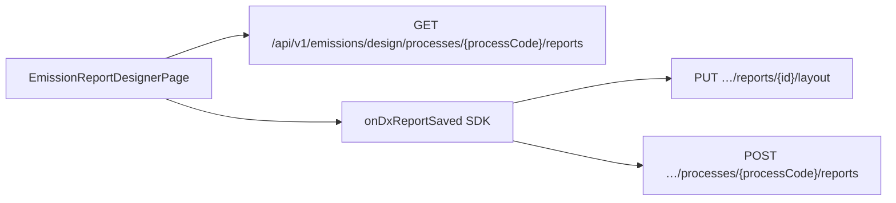
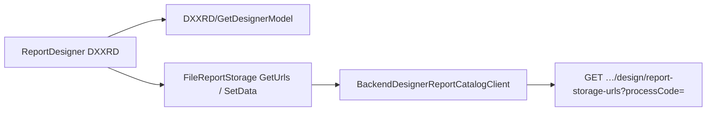

# Mapa de rutas — diseñador emisiones GEN-15 (Partes)

SoT operativo derivado de **CC ST #4** (27/11/2026). Complementa [persistencia-layouts-emisiones-dx.md](./persistencia-layouts-emisiones-dx.md) y [TR-011](../04-tareas/100-SistemaPartes/TR-011-reportes-emisiones.md).

## Superficie usuario

| Ruta / pantalla | Componente | Permiso |
|-----------------|-------------|---------|
| `/emisiones/disenador?cliente={tenant}` | `ReportDesignerHostPage` → SDK `EmissionReportDesignerPage` | `emission.design` |
| Menú `partes_disenador_emisiones` | Entrada Soporte técnico | mismo |
| Smart Capture (oleada 2 B) | `EmissionDesignSmartCaptureSlot` bajo lienzo | BYOK + `emission.design` |

Native: diseñador **excluido** (policy host).

## Flujo FE → API (catálogo shell)



- SelectBox de variantes: datos de **`pq_emission_reports`** (nombres visibles: `Spike B titulo`, `Consulta Partes`, `Pirulin`, etc.).
- `reportUrl` del lienzo DX: normalización host (`emissionReportCatalog.ts`, `EmissionReportDxStorageUrl.php`).

## Flujo DX Save / Save As (sidecar)



- Diálogo **Save Report** / **Save As**: lista = **intersección** archivos `data/layouts/*.repx` del sidecar **y** URLs permitidas del catálogo API (token `X-Paq-Sidecar-Schema-Token`).
- En lab suele mostrar **menos** ítems que el SelectBox del shell (p. ej. solo `partes.consultaDetallada.principal` y `partes_consultaDetallada_principal`).

## Rutas HTTP Partes (diseño)

| Método | Ruta | Rol |
|--------|------|-----|
| GET | `/api/v1/emissions/design/processes` | Procesos emisibles del usuario |
| GET | `/api/v1/emissions/design/processes/{processCode}/reports` | Catálogo variantes (shell) |
| POST | `/api/v1/emissions/design/processes/{processCode}/reports/hydrate-sidecar` | CC-ST-4: hydrate BD→sidecar (batch/puntual) |
| GET | `/api/v1/emissions/design/report-storage-urls?processCode=` | Catálogo filtrado para sidecar |
| GET | `/api/v1/emissions/design/field-schema?processCode=` | Schema semántico (Field List) |
| PUT | `/api/v1/emissions/design/reports/{id}/layout` | Persistir XML en BD |
| POST | `/api/v1/emissions/design/processes/{processCode}/reports` | Alta variante en catálogo |

Auth diseño: bearer usuario + `emission.design`. Token sidecar: header acordado en runbook Forge.

## Rutas sidecar ASP.NET (lab :5055)

| Prefijo | Uso |
|---------|-----|
| `/DXXRD/*` | Diseñador web (GetDesignerModel, OpenReport, callbacks save) |
| `/api/layout/apply` | Smart Capture camino B (mutación REPX en disco) |
| `/api/layout/put` | CC-ST-4: escribe REPX si falta en disco (if-not-exists) |
| `GET /health` | Liveness lab |

Vite proxea `/DXXRD` al sidecar (`frontend/vite.config.ts`).

## Fuentes de verdad

| Capa | SoT | Copia de trabajo |
|------|-----|------------------|
| Emitir / backup | `pq_emission_reports.layout_definition` (BD) | — |
| Diseñador DX | `.repx` en `data/layouts/` sidecar | obligatorio para DXXRD |
| Lista shell | BD | — |
| Lista Save DX | Disco sidecar ∩ catálogo API | puede **no** coincidir con shell si falta hydrate |

## Checklist diagnóstico (CC ST #4)

```powershell
# Catálogo shell (auth usuario)
# GET .../emissions/design/processes/partes.informes.consultaDetallada/reports

# Urls sidecar (token)
# GET .../emissions/design/report-storage-urls?processCode=partes.informes.consultaDetallada
# Header X-Paq-Sidecar-Schema-Token

# Disco sidecar
Get-ChildItem C:\Programacion\PaqSuite-IA-FRAMEWORK\services\dx-reporting\src\PaqSuite.DxReporting\data\layouts\*.repx
```

Comparar: **count(reports)** vs **count(urls)** vs **count(.repx)**.

## Referencias código

| Repo | Artefacto |
|------|-----------|
| Partes FE | `ReportDesignerHostPage.tsx`, `DxReportDesignerPanel.tsx`, `dxReportingConfig.ts` |
| Partes BE | `EmissionsController.php`, `EmissionReportDxStorageUrl.php` |
| Framework | `FileReportStorage`, `BackendDesignerReportCatalogClient`, `EmissionReportUrlNormalizer.cs` |
| SDK | `@paqsuite/react-core` `EmissionReportDesignerPage`, `emissionDesignApi` |