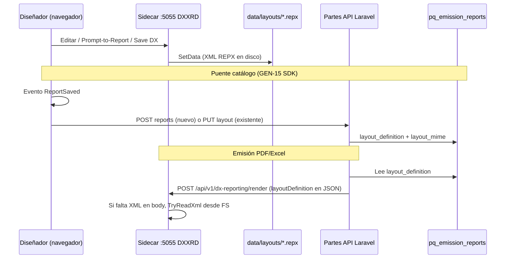

# Persistencia de layouts REPX — emisiones DevExpress (GEN-15)

Documento de referencia para operadores y desarrollo Partes cuando  
`PAQSUITE_EMISSION_DX_MODE=remote` y el diseñador usa el sidecar (`DXXRD` → `:5055`).

Complementa [TR-011](../04-tareas/100-SistemaPartes/TR-011-reportes-emisiones.md),  
[piloto IA TR-015](./adopcion-tr-015-piloto-ia-diseno-sidecar.md) y el README del sidecar en Framework  
(`services/dx-reporting/README.md`).

---

## 1. Dónde está físicamente el REPX

Hay **tres** ubicaciones posibles. Solo una es la **fuente de verdad** del producto al emitir.

| # | Ubicación física | Formato | Quién escribe | Quién lee al **emitir** |
|---|------------------|---------|---------------|-------------------------|
| **A (SoT producto)** | **SQL Server — BD tenant** (MONO: base operativa de la instalación) | Columna **`pq_emission_reports.layout_definition`** (texto XML REPX) + **`layout_mime`** | API Partes tras guardado en catálogo (SDK) | **Laravel** → envía XML en `layoutDefinition` al POST render del sidecar |
| **B (diseñador)** | **Disco del host del sidecar** ASP.NET | Archivo **`*.repx`** bajo `data/layouts/` | DevExpress Web Designer (`FileReportStorage`) | Sidecar **solo si** Laravel no mandó XML válido (fallback por `reportId` / código) |
| **C (fallback)** | **Repo Partes** — no es catálogo runtime | `backend/resources/emissions/*.repx` | Entrega / seed / fallback código | Laravel cuando la fila del catálogo no tiene XML REPX (consulta detallada Must) |

**No** existe un archivo `.repx` “dentro” de SQL Server: en BD el layout es **XML en una columna**.

Ruta típica sidecar (lab):

```text
PaqSuite-IA-FRAMEWORK/services/dx-reporting/src/PaqSuite.DxReporting/data/layouts/{reportUrl-normalizado}.repx
```

Config: `PaqSuite:LayoutStoragePath` → `data/layouts` (ver `appsettings.json` del sidecar).  
Esos `.repx` locales están en **`.gitignore`** del sidecar; no son el despliegue productivo del catálogo.

Muestras versionadas (evidencia / lab):  
Framework `services/dx-reporting/docs/evidence/samples/*.repx` (opcional, no las lee Partes en runtime).

---

## 2. Dónde conviene guardar **primero** (recomendación)

| Prioridad | Dónde | Motivo |
|-----------|--------|--------|
| **1 — Autoritativo** | **`pq_emission_reports.layout_definition`** (BD tenant) | Catálogo GEN-15, emisión Forge/Vercel, backup RDS, permisos por proceso; es el diseño que ustedes definieron al inicio (TR-011). |
| **2 — Copia de trabajo** | **`.repx` en el sidecar** | Obligatorio para el diseñador web DevExpress; no reemplaza al catálogo. |
| **3 — No usar como SoT** | Solo disco sidecar sin POST/PUT Partes | Válido para prueba local; **otra PC o preview no ve el layout** y la emisión puede usar otro informe. |

**Regla operativa:** después de diseñar (manual o Prompt-to-Report), asegurar que el XML quede en **BD** vía el flujo del SDK (§3). Tratar el `.repx` del sidecar como **cache del diseñador**, no como archivo maestro del negocio.

**Excepción:** informes con **`is_standard = 1`**. El `PUT …/layout` **no sobrescribe** la fila en BD; el layout editable del diseñador vive en el **sidecar** (`.repx`). Las variantes **no estándar** (`is_standard = 0`) sí persisten en **`layout_definition`**.

---

## 3. Proceso de guardado (flujo actual)



### 3.1 Guardado solo en el sidecar (DevExpress “Save”)

1. El usuario guarda en el diseñador.
2. DevExpress invoca `FileReportStorage.SetData` / `SetNewData`.
3. Se escribe **`data/layouts/{SafeUrl(reportUrl)}.repx`** en el servidor del sidecar.
4. **No** toca la BD Partes hasta que el host dispare **ReportSaved** (§3.2).

### 3.2 Guardado en catálogo Partes (BD) — flujo previsto al inicio

Montado en Partes con `EmissionReportDesignerPage` (`@paqsuite/react-core`) + `DxReportDesignerPanel`:

1. Tras guardar, DevExpress emite **ReportSaved** con `url` y `layoutDefinition` (XML).
2. El SDK normaliza el código (`SafeUrl`, coherente con nombre de archivo sidecar).
3. Si el código **no** está en el catálogo del proceso:
   - `POST /api/v1/emissions/design/processes/{processCode}/reports`  
     (body: `name`, `code`, `layoutDefinition`, `layoutMime`, opcional `setPrincipal`).
4. Si **ya** existe la variante:
   - `PUT /api/v1/emissions/design/reports/{reportId}/layout`.
5. `SpEmissionRepository` persiste en **`pq_emission_reports`** (tenant resuelto por `X-Paq-Cliente`).

Rutas API: `backend/routes/api.php` (grupo `emission.design`).

### 3.3 Emisión (qué layout se usa)

1. Partes arma el job y obtiene layout con `findReportLayoutForRender` / `findReportLayoutForRenderByCode`.
2. Si `layout_definition` contiene XML REPX válido (`XtraReportsLayoutSerializer`) → ese XML va al sidecar.
3. Si no, fallbacks (p. ej. REPX embebido consulta detallada en `resources/emissions/`).
4. Sidecar (`ReportRenderer`): usa **`layoutDefinition` del POST**; si viene vacío, intenta **`.repx` en `data/layouts`**; si no, grilla automática.

---

## 4. Comprobación rápida en lab (DEV)

```sql
-- BD tenant (ej. paqsystems_partesatencion_dev)
SELECT id,
       report_code,
       name,
       is_standard,
       is_principal,
       layout_mime,
       CASE
         WHEN layout_definition LIKE '%XtraReportsLayoutSerializer%' THEN LEN(layout_definition)
         ELSE NULL
       END AS repx_xml_len
FROM pq_emission_reports
WHERE process_code = 'partes.informes.consultaDetallada'
ORDER BY id;
```

- **`repx_xml_len` NULL** en una variante custom → el layout **no** está en BD; puede existir solo como `.repx` en el sidecar.
- Tras guardado catálogo correcto → **`repx_xml_len`** grande (miles de caracteres).

Sidecar (misma máquina donde corre `dotnet run`):

```powershell
Get-ChildItem "...\PaqSuite.DxReporting\data\layouts\*.repx" | Select-Object Name, Length, LastWriteTime
```

---

## 5. Lab local Partes + sidecar

| Variable / pieza | Rol |
|------------------|-----|
| `VITE_DX_REPORTING_HOST=http://127.0.0.1:5055` | Proxy `/DXXRD` al sidecar |
| `PAQSUITE_EMISSION_DX_MODE=remote` | Emisión usa sidecar |
| Sidecar en `:5055` | Diseñador + archivos `data/layouts` |
| `.env.local` frontend | **No commitear** |

OpenAI / Prompt-to-Report: credenciales solo en **user-secrets** del sidecar (TR-015), no en Laravel.

---

## 6. Resumen una línea

**Emitir y desplegar:** el REPX “oficial” está en **`pq_emission_reports.layout_definition`**.  
**Diseñar:** DevExpress escribe además un **`.repx` en el sidecar**; hay que **sincronizar al catálogo** (POST/PUT) para que lab, preview y prod compartan el mismo layout.

---

## Historial

| Fecha | Nota |
|-------|------|
| 2026-11-05 | Documento inicial — dual persistencia sidecar + BD; SoT BD para producto. |
