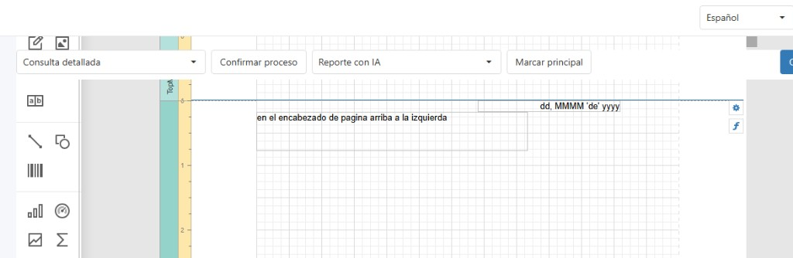
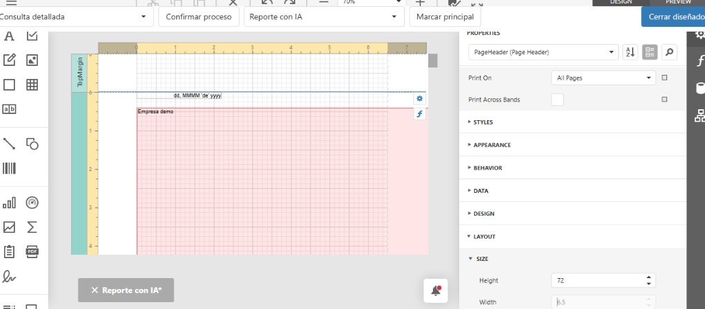

# Sesión de pruebas DEV — SPEC-015 · checklist emisiones IA (Partes-Atención)

| Campo | Valor |
|-------|--------|
| Fecha | 2026-11-27 |
| Entorno | `cliente=DEV` (lab page header) |
| Proceso | `partes.informes.consultaDetallada` — **Consulta detallada** |
| Matriz SoT | Framework [`15-reportes-emisiones-ia-checklist-matriz.json`](../../../PaqSuite-IA-FRAMEWORK/docs/02-producto/15-reportes-emisiones-ia-checklist-matriz.json) |
| Guía operativa | [`guia-manual-prompts-checklist-chk-emision-ia.md`](./guia-manual-prompts-checklist-chk-emision-ia.md) |
| **Cómo testear / seguir** | [`runbook-pruebas-prompts-naturales-emision-ia.md`](./runbook-pruebas-prompts-naturales-emision-ia.md) (fases 0–3, LAB-ZONA-01) |
| Ítem foco inicial | **CHK-06** — empresa fila 1, sup. izq., `PageHeaderBand` |

---

## Objetivo de la sesión

Validar en **DEV** el camino B (Smart Capture + apply sidecar) con prompts **naturales** (no solo el texto canónico del checklist) y registrar desvíos antes de ampliar la batería CHK-07+.

Esta nota **abre** la sesión: incluye setup, criterios de CHK-06 y los **dos primeros hallazgos** ya reproducidos en diseñador.

---

## Normalidad de uso (producto) vs checklist técnico

En operación real, el usuario **no** habla en frases CHK aisladas: usa **prompts naturales** («agregar empresa», «poné fecha arriba») o un **brief estructurado por zonas del reporte** — banda DevExpress + lista de contenidos (campos, literales, totales).

| Capa | Rol |
|------|-----|
| **Matriz CHK + `promptCanonico`** | Contrato de regresión (planner + apply + scripts); **línea base** automatizada. |
| **DEV / piloto** | Validar **lenguaje natural** y **especificaciones multi-zona** (turno SC completo, LLM, diseñador). |
| **Objetivo de madurez** | Que el mismo layout que hoy se arma con N ítems CHK se pueda pedir en **un mensaje** o en un bloque «Page Header → … / Detalle → …». |

Los cierres F1 de oleadas 4–12 demostraron **whitelist + sidecar** con prompts canónicos; los fallos de esta sesión evidencian un **hueco de capa de prueba** (ver § abajo), no necesariamente un retroceso del apply canónico.

---

## Brecha smoke / automatizado vs DEV (2026-11-27)

| Qué corre en CI / scripts | Qué corre en sesión DEV |
|---------------------------|-------------------------|
| `eval-emission-ia-oleada5-apply.ps1` aplica **`expectedActions` de la matriz** directo al sidecar (sin SC, sin LLM) | Smart Capture → `DesignLayoutActionPlanner::plan` → apply → lienzo |
| PHPUnit checklist: **`promptCanonico`** por CHK | Paráfrasis y briefs multi-línea |
| Layout **restaurado** antes de cada assert | Estado acumulado (Guardar/Descartar, CHK previos) |
| Casos con heurística vacía → **no ejercitados** | Ej. `agregar empresa` → **LLM** (Caso B) |

**Seguimiento acordado (trazabilidad, sin implementar aquí):**

1. Tests planner: variantes naturales mínimas por CHK (empezar CHK-06 VAR-A/B).
2. Script **planner → apply** (HTTP turno o `fromHeuristics`/`plan` en test) además del apply «desde matriz».
3. Documentar en TR/CC que **F1 histórico ≠ cobertura de lenguaje natural**.
4. Spec futura: **parsing de brief por bandas** (§ ejemplo Consulta detallada).

---

## Especificación por zonas — ejemplo Consulta detallada

Formato **objetivo** de pedido en SC (pegar como un solo mensaje o por secciones en turnos encadenados):

```text
Diseño reporte "Consulta Detallada"

Page Header
	empresa
	fecha/hora
	Titulo (literal)
	titulos de los campos en detalle

Page Footer
	hoja x/x

Group Header (por Codigo Cliente)
	cliente (codigo)
	cliente (razon Social)

Detalle
	fecha
	asistente (codigo)
	tipo tarea (codigo)
	observacion
	duracion

Group Footer
	literal (Total)
	sumatoria de "duracion"
```

### Mapa tentativo → whitelist / CHK (piloto v1)

| Zona solicitada | Ítem / acción aprox. | Notas MVP |
|-----------------|----------------------|-----------|
| Page Header — empresa | CHK-06 `setPageHeaderEmpresa` | Lab: texto demo; producción: nombre tenant |
| Page Header — fecha/hora | CHK-07 `setPageHeaderFecha` | MVP: fecha impresión, **sin hora** (`dd, MMMM 'de' yyyy`); **hora** = gap |
| Page Header — título literal | CHK-03/08 `setReportTitle` + fila 2 | Literal explícito en el brief |
| Page Header — títulos columnas | CHK-04 `addPageHeaderColumnLabels` | Requiere columnas en detalle |
| Page Footer — hoja x/x | — | **No** en whitelist v1; distinto de CHK-09 **Report** Footer |
| Group Header — por código cliente | CHK-18 `addGroupByField` | Hoy MVP agrupa `clienteNombre`; pedido **Codigo Cliente** → `clienteCode` (validar planner/GEN-37) |
| Group Header — código + razón social | CHK-19 (parcial) | Caption / negrita; dos campos en GH = diseño manual o oleada futura |
| Detalle — campos listados | CHK-01 `addDetailField` × N | Mapeo semántico: asistente → `usuarioCode`; tipo tarea → `tipoTareaCode`; duración → `duracionMinutos` |
| Group Footer — Total + suma duración | CHK-20 `addGroupByField` + `addGroupSum` | Copy «Total minutos»; literal «Total» puede ser estático GH/GF |

**Caso de prueba DEV propuesto (LAB-ZONA-01):** pegar el bloque completo en SC con layout limpio → anotar cuántas acciones planifica el turno, cuáles apply, cuáles quedan como **gap** (hora, `x/x`, agrupación por código).

---

## Pre-requisitos (checklist rápido)

| # | Verificación |
|---|----------------|
| 1 | URL lab: `http://127.0.0.1:<puerto>/emisiones/disenador?cliente=DEV` (no usar `PQ` como `cliente` en la URL). |
| 2 | Login con usuario que tenga `emission.design` (ej. **PQ**). |
| 3 | Sidecar: `GET http://127.0.0.1:5055/health` → `status: ok`. |
| 4 | BYOK Smart Capture: credencial **habilitada** en preferences del panel SC. |
| 5 | Proceso **Consulta detallada** → **Confirmar proceso**; variante anotada (ej. Spike B título / principal). |
| 6 | Tras cada apply: anotar **Guardar** o **Descartar** antes del siguiente caso. |

---

## Contrato CHK-06 (referencia rápida)

| Aspecto | Esperado (matriz / oleada 5) |
|---------|------------------------------|
| Prompt canónico (checklist) | `Poné el nombre de la empresa arriba a la izquierda` |
| Acción whitelist | `setPageHeaderEmpresa` |
| Control | `lblPageHdr_Empresa` en **PageHeaderBand** |
| Texto en lab DEV | `Empresa demo` (sin nombre explícito en el mensaje) |
| Posición | Fila 1, `Y ≈ 0`, alineado a la izquierda (`Row1Y` en sidecar) |
| Tamaño control (applier) | Si ancho &lt; 50: **400×18** px lógicos (`LayoutPageHeaderEmpresaApplier`) |
| Convive con CHK-07 | Fecha (`pageInfoFecha`) misma fila 1, **derecha** |

Cierre formal previo: [D-VERIFICACION T2 CHK-06](../04-tareas/100-SistemaPartes/D-VERIFICACION-TR-015-update-e-t2-chk06-2026-11-20.md) (prompt **canónico** + heurística + apply).

---

## Variantes de lenguaje a probar en DEV

Además del prompt canónico, registrar al menos:

| ID variante | Prompt (pegar en SC) | Ruta planner esperada |
|-------------|----------------------|------------------------|
| CHK-06-CANON | `Poné el nombre de la empresa arriba a la izquierda` | Heurística → `Empresa demo` |
| CHK-06-VAR-A | `agregar empresa en el encabezado arriba a la izquierda` | Heurística (sinónimos **agregar** / **encabezado**) o LLM si no matchea |
| CHK-06-VAR-B | `agregar empresa` | Heurística **vacía** en DEV → **LLM** (confirmado probe 2026-11-27) |

**Criterio de éxito** para todas las variantes: mismo resultado visual y REPX que CHK-06-CANON (texto correcto, banda correcta, ancho acotado).

---

## Hallazgos iniciales (2026-11-27)

### Caso A — CHK-06-VAR-A · texto literal de ubicación

| Campo | Valor |
|-------|--------|
| Prompt usado | `agregar empresa en el encabezado arriba a la izquierda` |
| Resultado | **Fallo** |
| Captura |  |

**Observado**

- En el lienzo aparece un label con el texto **`en el encabezado de pagina arriba a la izquierda`** (frase de **ubicación**, no nombre de empresa).
- Coexiste máscara de fecha `dd, MMMM 'de' yyyy` en la misma zona superior (posible mezcla fila 1 / controles previos).
- La sensación visual es de control en **área de encabezado** pero con **contenido semántico incorrecto** (instrucción del usuario en lugar de `Empresa demo` o nombre explícito).

**Esperado**

- `lblPageHdr_Empresa` con `Text="Empresa demo"` (tenant DEV) o texto extraído si el usuario lo nombra entre comillas.
- Sin volcar al REPX restos del prompt («encabezado», «arriba», «izquierda») como `Text` del label.

**Evidencia heurística (tenant `DEV`, 2026-11-27)**

`DesignLayoutPageHeaderHeuristics::tryMatchEmpresa` con el prompt VAR-A devuelve **`setPageHeaderEmpresa` + `text: "Empresa demo"`** (sin LLM). El texto literal de ubicación del Caso A **no** viene del planner heurístico en lab; revisar `cliente=DEV` en URL, payload real del turno SC y capa apply/REPX.

**Hipótesis técnica (para investigar en D/E)**

1. **Tenant / planner**: URL distinta de `DEV` → heurística vacía → **LLM** con `payload.text` mal extraído.
2. **Pipeline post-planner**: apply sidecar u otra acción en el mismo turno (p. ej. texto estático).
3. **Extracción** (si en el futuro se extrae del mensaje): ampliar `isEmpresaPlacementNoise()` y sinónimos (`agregar`, `encabezado de página`).

---

### Caso B — CHK-06-VAR-B · colocación OK, ancho «infinito»

| Campo | Valor |
|-------|--------|
| Prompt usado | `agregar empresa` (sin indicación de posición) |
| Resultado | **Parcial** — contenido `Empresa demo` coherente; **layout roto** |
| Captura |  |

**Observado**

- Texto **`Empresa demo`** visible en **PageHeader** (alineado a convención CHK-06 en contenido).
- El control (o la banda) **estira el ancho usable**: en propiedades, **PageHeader** muestra dimensiones anómalas (p. ej. ancho ~6,5 en unidades del diseñador) y la zona rosa de detalle queda comprimida o con aspecto de **ancho desproporcionado** («campo infinito»).
- Convive con control de fecha en la misma banda.

**Esperado**

- `lblPageHdr_Empresa` con ancho acotado (applier: 400×18 si venía &lt; 50).
- **PageHeaderBand** con alto ≥ 72 y sin forzar ancho de página al máximo del control.
- Layout de tres filas legible (fila 1: empresa + fecha).

**Hipótesis técnica**

1. **LLM / apply previo**: label creado con `WidthF` muy grande; el applier solo corrige si `WidthF < 50` (`LayoutPageHeaderEmpresaApplier.cs`).
2. **Re-aplicación sobre control existente**: conviene probar **Descartar** → layout limpio → repetir VAR-B y capturar REPX.
3. **Orden CHK-07 + CHK-06**: anotar si la fecha se aplicó antes o después del nombre empresa.

### CHK-07 — fecha pegada a la izquierda (corregido en sidecar, 2026-11-27)

| Ítem | Detalle |
|------|---------|
| **Síntoma** | Tras CHK-06 OK, CHK-07 dejó `pageInfoFecha` al lado de `Empresa demo` (misma esquina izquierda). |
| **Causa** | Layouts del diseñador DX con `ReportUnit="Inches"` y `PageWidthF="8.5"`; el applier usaba ancho imprimible y control de **220** en unidades de lab (850), por lo que `targetX` ≈ 0. |
| **Fix (FW)** | `LayoutPageHeaderMetrics` + appliers CHK-06/07/05: escala pulgadas, `PageWidthF`, márgenes; test con `Report-prueba-ia-1.repx`. |
| **Re-test DEV** | Reiniciar sidecar (`.\start-lab-sidecar.ps1`), volver a aplicar CHK-07 (o Descartar y repetir 06+07). Esperado: empresa X≈0, fecha X≈5.3″ (derecha fila 1). |

---

## Plantilla de registro (sesión DEV)

Copiar filas a un D-VERIFICACION de seguimiento o a la tabla de [`guia-manual-prompts-checklist-chk-emision-ia.md`](./guia-manual-prompts-checklist-chk-emision-ia.md) §Registro acumulado.

```markdown
| Variante | Prompt | Planner (H/LLM) | Apply | Visual | REPX / notas | Captura |
|----------|--------|-----------------|-------|--------|--------------|---------|
| CHK-06-CANON | Poné el nombre… | | | | | |
| CHK-06-VAR-A | agregar empresa en el encabezado… | | | Fallo | texto literal ubicación | caso-a |
| CHK-06-VAR-B | agregar empresa | | | Parcial | ancho banda/control | caso-b |
```

**Al cerrar cada caso**, si es posible, exportar del turno SC o de red:

- `actions[]` devueltas por el backend (`action` + `payload.text`).
- Confirmación apply sidecar (`changed` / `noop`).

---

## Orden sugerido para el resto de la sesión

1. **Smoke canónico** CHK-06-CANON en layout limpio (Descartar antes) — baseline verde.
2. Reproducir **VAR-A** y **VAR-B** con anotación H vs LLM (log `partes.emissionDesign` o respuesta API del turno).
3. **CHK-07** en el mismo layout (`Agregá la fecha con el mes en letras arriba a la derecha`) y verificar convivencia fila 1.
4. **LAB-ZONA-01**: brief «Consulta detallada» por zonas (§ arriba) — registrar plan vs layout.
5. Seguir matriz según prioridad del equipo (oleadas cerradas 15–17, 28, o ítems pendientes de re-smoke).

---

## Referencias

| Documento | Uso |
|-----------|-----|
| [SPEC-015 oleada 5 page header](../05-open-spec/updates/100-SistemaPartes/SPEC-015-ia-diseno-informes-oleada-5-page-header-update.md) | Contrato filas page header |
| [smoke oleada 5 CHK-04](./smoke-oleada5-page-header-chk04.md) | Variante con columnas en detalle |
| FW `LayoutPageHeaderEmpresaApplier.cs` | Apply CHK-06 |
| Partes `DesignLayoutPageHeaderHeuristics.php` | Match CHK-06 sin LLM |

---

## Estado del documento

| Estado | Notas |
|--------|--------|
| **Abierto** — sesión en curso | Casos A y B registrados; pendiente completar tabla y veredicto final de sesión. |